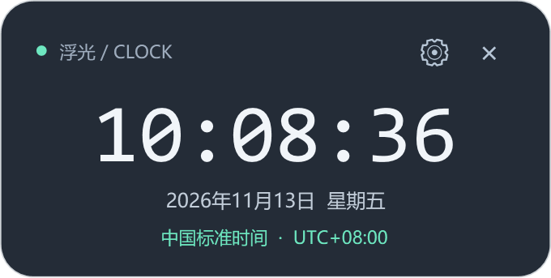
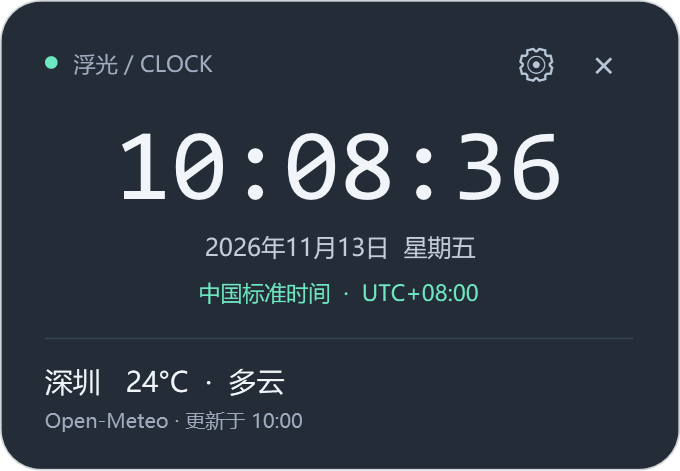
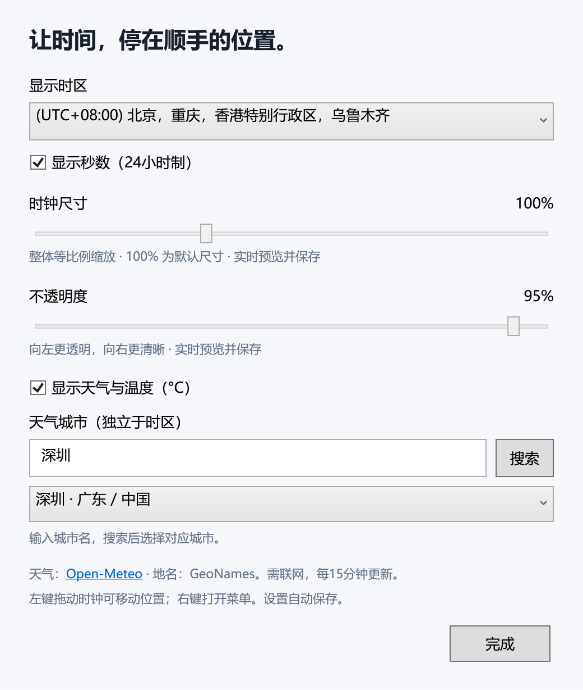

# 浮光时钟

Windows 原生悬浮桌面时钟，使用 WPF / .NET 10，无第三方程序包。

## 控件效果图

以下图片由项目现有 WPF 界面渲染，时间、日期、城市和天气均为示例数据，不代表实时天气。

### 基础时钟



### 天气面板



### 设置面板

可选择时区、调节尺寸和不透明度，并设置天气城市。



## 使用

双击 `启动时钟.cmd` 或 `release/FloatingClock.exe`。需要 Windows 10/11 与 .NET 10 桌面运行时（当前电脑已具备）。发布目录中的文件请一并保留。

- 时钟始终置顶；左键拖动面板调整位置，自动记住。
- 时钟和设置窗口不占用任务栏按钮，入口位于右下角系统托盘（可能收在向上箭头内）。双击托盘图标显示/隐藏时钟，右键可打开设置、刷新天气或退出。
- 点击齿轮或右键 → 设置：选择系统支持的全球时区，自动处理夏令时。
- 不透明度滑块：25%～100%，实时预览，自动保存；设置窗口始终清晰可见。
- 时钟尺寸滑块：60%～180%，时间、文字及面板整体等比例缩放，实时预览并记住大小；100% 为默认尺寸。
- 支持显示/隐藏秒数，使用24小时制。
- 天气默认关闭。搜索城市后从结果选择，即可显示天气和摄氏温度；城市与时区分别配置。
- 天气每15分钟更新，可右键手动刷新；网络错误不会影响时钟。
- 点击 × 或右键 → 退出。

设置保存到 `%LOCALAPPDATA%\FloatingClock\settings.json`。关闭程序后删除此文件可重置设置。

置顶适用于普通桌面窗口；系统安全桌面、独占全屏或其他置顶窗口可能遮挡。

## 开发与发布

```powershell
dotnet build -c Release
dotnet publish -c Release -r win-x64 --self-contained false -o release
```

天气服务：[Open-Meteo](https://open-meteo.com/)，地名数据：[GeoNames](https://www.geonames.org/)。请求会发送搜索的城市名或所选城市坐标。免费接口用于非商业用途，商用需遵循服务商许可；数据使用遵循其署名要求。天气为模型当前估计值，不保证为现场实测。
